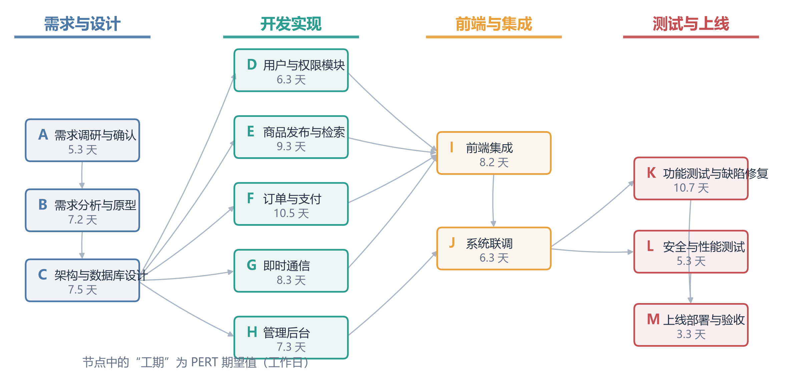
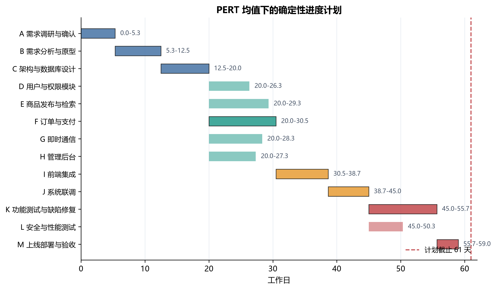
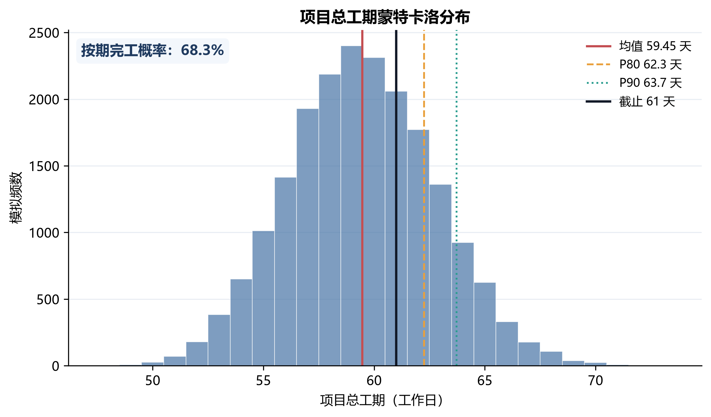
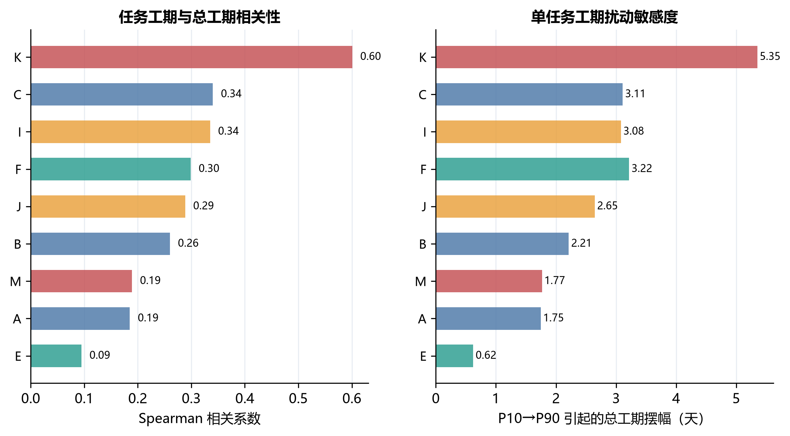

# Monte Carlo Software Project Schedule Risk Assessment

《软件工程管理》课程作业题目一的完整可运行代码。

本项目以“校园二手交易平台 V1.0”为案例，建立 13 项任务的 WBS 与依赖网络，结合 PERT 三点估算、Beta 分布和蒙特卡洛模拟，评估软件项目工期风险，并与传统 CPM 单点计划进行对比。

## 主要结果

| 指标 | 结果 |
|---|---:|
| 任务数量 | 13 |
| 蒙特卡洛模拟次数 | 20,000 |
| CPM 确定性工期 | 59.00 天 |
| 模拟均值 | 59.45 天 |
| P50 | 59.39 天 |
| P80 | 62.26 天 |
| P90 | 63.72 天 |
| 61 天计划按期完工概率 | 68.3% |
| 关键路径 | A → B → C → F → I → J → K → M |

## 项目结构

```text
monte_carlo_schedule_risk/
├── config.py               # 项目、截止日期、模拟次数和随机种子
├── schedule_model.py       # PERT、Beta、CPM、模拟与敏感度分析
├── plots.py                # 网络图、甘特图、直方图、CDF 和敏感度图
├── main.py                 # 一键运行全部分析
├── data/
│   └── tasks.csv           # WBS、依赖关系与 a/m/b 工期
├── tests/
│   └── test_model.py       # 自动测试
├── results/                # 运行后生成的结果和图表
│   └── figures/
└── requirements.txt
```

## 快速运行

推荐使用 Python 3.12。

```bash
python -m venv .venv

# Windows
.venv\Scripts\activate

# macOS / Linux
source .venv/bin/activate

python -m pip install -r requirements.txt
python main.py
```

运行完成后，结果写入 `results/`，图表写入 `results/figures/`。

自动测试：

```bash
python -m unittest discover -s tests -v
```

## 方法说明

1. 由每项任务的乐观工期 `a`、最可能工期 `m` 和悲观工期 `b` 计算 PERT 均值与标准差。
2. 将 PERT 均值和方差映射为 Beta 分布参数，在 `[a, b]` 区间内随机采样。
3. 按任务依赖图进行拓扑排序，计算每次模拟的最早开始和最早完成时间。
4. 取所有任务最早完成时间的最大值作为项目总工期。
5. 统计项目工期均值、分位数、按期完工概率和超期概率。
6. 使用 Spearman 相关系数和单任务 P10→P90 摆幅识别高风险任务。

## 关键图表

### 任务依赖网络



### 确定性进度计划



### 工期分布



### 敏感度分析



## 参数修改

统一参数位于 `config.py`：

- `DEADLINE_DAYS`：计划截止工期
- `N_SIMULATIONS`：模拟次数
- `RANDOM_SEED`：随机种子

任务数据位于 `data/tasks.csv`。修改任务、依赖或三点工期后，重新运行 `main.py` 即可复现全部结果。

## GitHub 分享

将本目录上传到 GitHub 后，在仓库页面复制公开链接，并填写到课程报告“代码可用性说明”一节。

首次上传示例：

```bash
git init
git add .
git commit -m "feat: add Monte Carlo schedule risk analysis"
git branch -M main
git remote add origin https://github.com/<your-account>/<repo-name>.git
git push -u origin main
```

## 许可证

MIT License，详见 `LICENSE`。
